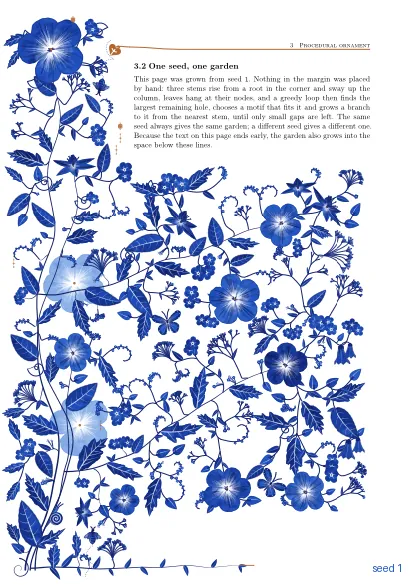
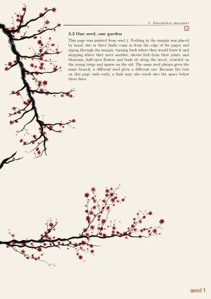
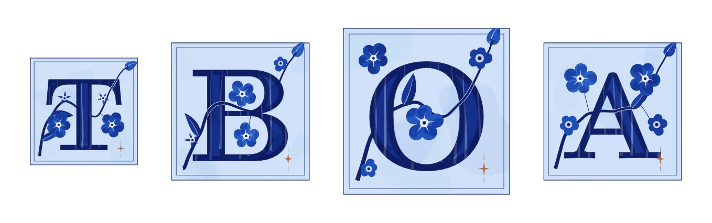
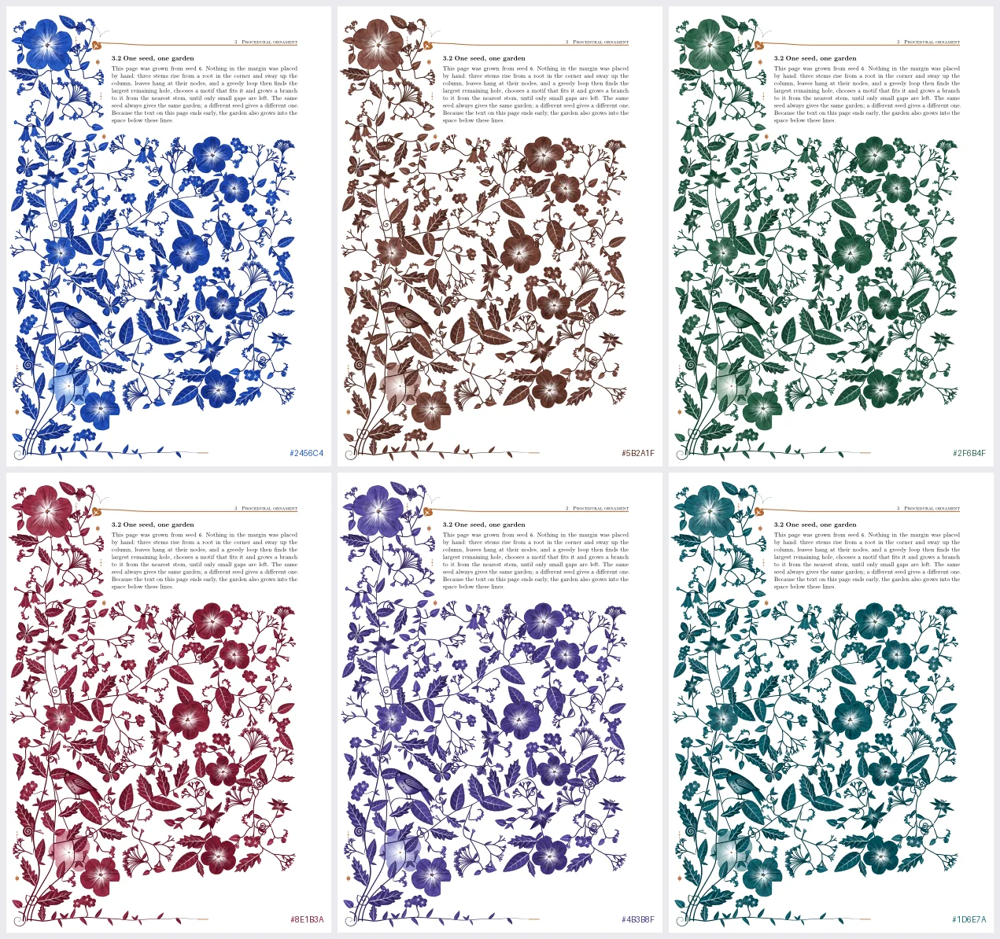
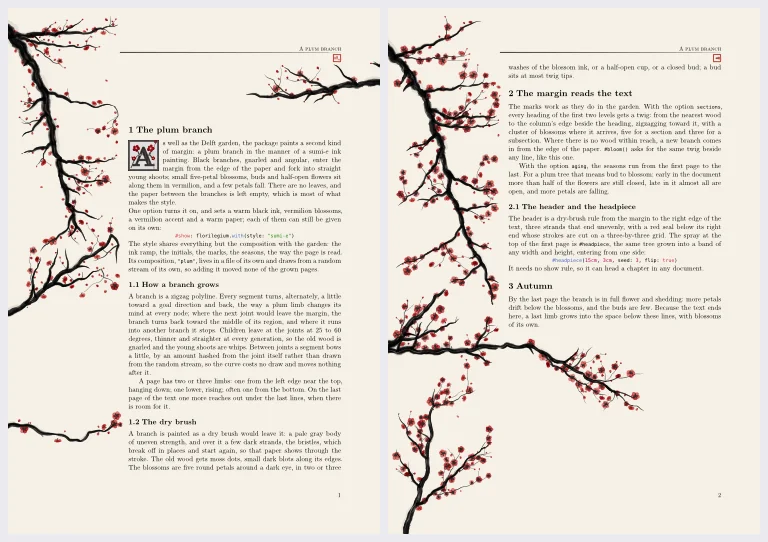
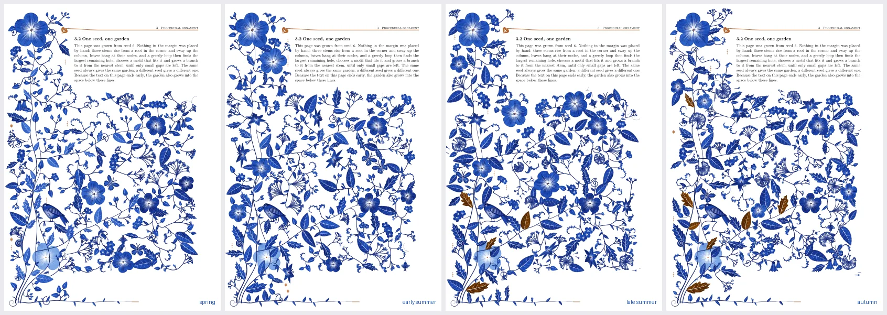

# florilegium

Procedurally drawn floral margins for Typst, in Delft blue or in a sumi-e plum style.
Every page grows its own garden in the left margin, around your headings and into the space
your text leaves free. Everything is drawn by a WebAssembly plugin; there are no images.

This is a Typst port of Kevin Raymond's LuaLaTeX package
[florilegium](https://github.com/kevinraymond/florilegium). The drawing code is his,
translated from Lua to Rust.

<p>
  
  
</p>

## Install

The package isn't on Typst Universe yet. Copy it into your local package directory:

```sh
# macOS; on Linux use ~/.local/share/typst/packages/local/florilegium/0.1.0
dir=~/Library/Application\ Support/typst/packages/local/florilegium/0.1.0
mkdir -p "$dir"
cp -R florilegium.typ florilegium.wasm fonts typst.toml "$dir"
```

Then import it with `#import "@local/florilegium:0.1.0": *`.

On typst.app, upload `florilegium.typ`, `florilegium.wasm` and `fonts/` next to your
document and use `#import "florilegium.typ": *`.

Requires Typst 0.14 or later.

## Quick start

```typ
#import "@local/florilegium:0.1.0": *
#show: florilegium.with(sections: true, aging: true)

= Introduction

#initial("T", lines: 4)[his paragraph opens with a decorated initial.]

A line that gets a flower beside it in the margin. #bloom()

...

#textend()   // last thing in the document: the garden fills the space below the text
```

## Options

`florilegium.with(..)` sets up the page and draws the margin behind it.

| option | default | |
|---|---|---|
| `style` | `"delft"` | `"delft"` (cobalt on white) or `"sumi-e"` (black plum branch, red blossoms, warm paper) |
| `seed` | `none` | `none` gives each page its own garden from its page number; an integer fixes it |
| `sections` | `false` | a flower beside every level 1 and 2 heading |
| `aging` | `false` | the garden runs from spring on the first page to autumn on the last |
| `visitors` | `true` | butterflies, bees, snails and birds |
| `ink` | `auto` | the main color; the whole palette is derived from it (try `rgb("#5B2A1F")` for sepia) |
| `accent` | `auto` | the color of the hairlines and heading flowers |
| `blossom` | `auto` | the color of the flowers; `none` uses `ink` |
| `fill` | `auto` | the paper color |
| `composition` | `auto` | `"grown"`, `"plum"`, or `"authored"` (a fixed, hand-placed design; A4 with the default margins only) |
| `margin` | `true` | `false` turns the margin off, leaving `initial`, `draw` and `headpiece` |
| `paper` | `"a4"` | |
| `page-margin` | `(left: 68mm, right: 22mm, top: 32mm, bottom: 30mm)` | the garden lives in the left margin, so keep it wide |
| `headsep`, `footskip` | `8mm`, `30pt` | distance from the text to the header and footer |
| `header`, `footer` | `none`, page number | |

Set the page through these options, not with your own `set page`: the garden reads the page
geometry from them and won't notice changes made elsewhere.

## In the text

| | |
|---|---|
| `#bloom()` | a flower in the margin beside this line |
| `#bloom("lily")` | a particular motif: `flower`, `lily`, `blossoms`, `bells`, `umbel`, `cyme`, `sprig`, `bud`, `budding`, `seedhead`, `leaf`, `tendril`, `butterfly`, `bee` |
| `#age(0.8)` | the season from here on: 0 spring, 0.5 summer, 1 autumn (use instead of `aging`) |
| `#textend()` | put at the end of the text so the last page's garden can grow underneath it |
| `#initial("E", lines: 5)[very ...]` | a decorated initial, `lines` lines tall, with the paragraph set beside it. The letter still copies as part of the word. `font:` takes the bytes of another OpenType font. |
| `#draw("flower", size: 1.3, angle: 20deg)` | one motif on its own, as an inline image. See `examples/specimen.typ` for all of them. |
| `#headpiece(15cm, 3cm, seed: 3, flip: true)` | a sumi-e plum spray filling a box, e.g. above a chapter title. Works without the show rule. |



## Styles and colors



`ink` sets the whole palette, from the darkest line to the palest wash.



```typ
#show: florilegium.with(style: "sumi-e", sections: true, aging: true)
```

The sumi-e style supports the same options and marks: twigs reach to the headings and to
`#bloom()`, and the seasons and the last page work the same way.



*`aging`: spring, early summer, late summer, autumn.*

## Good to know

- **Speed.** Each page takes about a second to compile. A page adds about 0.6 MB to the PDF.
- **Reproducible.** The same document always gives the same gardens. Change `seed` to get
  different ones.
- **One compilation.** The margin finds headings, `bloom` marks and the text end through
  `query`/`locate`, so Typst may need a few layout passes, but no second run.
- **Left margin only.** There is no mirrored variant for two-sided documents yet.

## Examples

`examples/` has complete documents; compile them from the repository root with
`typst compile --root . examples/showcase.typ`.

- `showcase.typ`: sections, `bloom`, initials and seasons, explained page by page
- `grown.typ` and `authored.typ`: the two Delft compositions
- `sumi-e.typ`: the plum style with a headpiece
- `specimen.typ`: every motif from `#draw`
- `variant.typ`: one page for any seed and color, e.g.
  `typst compile --root . --input seed=6 --input ink=5B2A1F examples/variant.typ out.pdf`

## Development

`florilegium.wasm` is committed, so you only need Rust to change the drawing. The source is
in `plugin/`; `make plugin` rebuilds it (needs the `wasm32-unknown-unknown` target), `make`
builds the examples, and `make baseline` / `make check` confirm a refactor leaves the output
unchanged. [CLAUDE.md](CLAUDE.md) maps the code.

The method follows Wong, Zongker & Salesin,
[*Computer-Generated Floral Ornament*](https://dl.acm.org/doi/10.1145/280814.280948)
(SIGGRAPH 1998): grow stems, then repeatedly fill the largest free space within reach with
a motif that fits. Kevin Raymond wrote the original in Lua for LuaLaTeX, in answer to
[a Reddit question](https://www.reddit.com/r/LaTeX/comments/1xixznw/how_do_you_make_these_flowers_in_latex/);
that version is still in this repository's git history and at
[kevinraymond/florilegium](https://github.com/kevinraymond/florilegium).

## License

MIT, © 2026 Kevin Raymond and Mark Groeneveld. The bundled Latin Modern Roman Bold font is under the GUST Font License.
